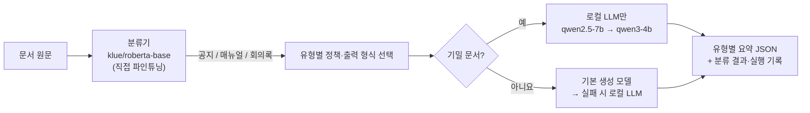

# 문서 분류 + 유형별 요약 서비스

사내 문서(공지·매뉴얼·회의록)를 **직접 학습한 분류기**로 분류하고, 예측한 유형에 맞는 형식으로 **생성 LLM이 요약**하는 서비스입니다. 분류와 생성은 LangChain으로 연결하고 FastAPI로 제공합니다.

> ⚠ **진행 중**: 분류기는 validation 기준으로 선정했고 test 평가는 아직 하지 않았습니다. 생성 모델 선택은 LLM 채점 기준의 **잠정** 결과이며, 팀원 블라인드 채점으로 검증한 뒤 확정합니다.

## 왜 만들었나

- 사내 문서는 유형마다 읽는 사람이 챙겨야 할 내용이 다릅니다. 공지는 대상·일정·할 일, 매뉴얼은 순서·주의 사항, 회의록은 결정·담당·후속 조치가 중요합니다.
- 기밀 문서가 많고 문서가 길수록 상용 API 비용이 늘어납니다. 그래서 **로컬 LLM(Ollama)과 상용 API를 품질·시간·비용·운영 조건으로 실측 비교**해, 로컬로 충분한지 근거를 만듭니다.

## 처리 흐름



학습한 분류기의 **실제 예측**으로 요약 정책과 출력 형식을 고릅니다. 정답 라벨은 쓰지 않습니다. 기밀 문서는 외부로 보내지 않고 로컬 LLM에서만 요약하며, 생성 모델이 응답하지 않으면 다음 모델로 자동 전환합니다(기밀 문서는 로컬 모델 사이에서만).

## 결과 한눈에 보기

### 분류 모델 (validation 120건)

| 모델 | Macro-F1 | 학습 시간 | 학습 VRAM | CPU 1건 추론 | |
|---|---|---|---|---|---|
| TF-IDF + 로지스틱 회귀 (기준) | 0.950 | 0.2초 | – | 0.3ms | |
| **klue/roberta-base** (lr 1e-5) | **1.000** (seed 3개) | 26초 | 2.1GB | 21ms | **선정** |
| koelectra-small (14M) | 0.983 | 26초 | 0.3GB | 7ms | 가장 가벼운 대안 |

- 사전학습 모델 5개 × 학습률 3개, 상위 설정은 seed 3개로 반복해 **29회** 파인튜닝했습니다.
- 선정 규칙: seed 평균 Macro-F1 최고점에서 0.01 이내는 동점 → 추론 속도 → 표준편차 → 파라미터 수 순으로 선택


### 생성 모델 (eval 24건 × 2회, LLM 채점)

| 모델 | 사용 가능률 | 읽기용 사용 가능률 | 환각률 | 칸 정확도 | 응답 평균 | VRAM | 1,000건 API 비용 | |
|---|---|---|---|---|---|---|---|---|
| **gpt-6-luna** (상용) | **0.75** | **0.94** | 0.06 | **0.92** | 2.57s | – | $0.16 | **잠정 선택** |
| qwen2.5:7b (로컬) | 0.58 | 0.85 | **0.02** | 0.88 | 2.21s | 4.4GB | $0 | 환각 최소, 읽기용으로는 하한 안 |
| qwen3:4b-instruct (로컬) | 0.46 | 0.73 | 0.19 | 0.83 | **1.74s** | 3.0GB | $0 | 가장 빠름 |

- **사용 가능률**(주 지표): 알림·일정·담당 지정처럼 자동화에 그대로 써도 되는 요약의 비율. 형식 정상, 환각·수치 오류·외국어 없음, 핵심 내용 포함률 0.67 이상, **칸마다 맞는 내용**이 모두 만족되어야 합니다.
- **읽기용 사용 가능률**: 칸 오류만 빼고 판정한 비율. 사람이 요약을 읽기만 하는 경우의 기준입니다.
- 로컬 5개 모델을 개발 데이터로 먼저 비교했습니다. 칸 규칙과 퓨샷 예시, 구조화 출력으로 프롬프트를 개선한 뒤 상위 2개를 골랐습니다.
- 선택 규칙(최종 비교 결과를 보기 전에 정함): 로컬의 사용 가능률이 상용보다 0.10 이하로만 낮고 환각률이 0.10 이하로만 높으면 로컬 우선 → qwen2.5:7b가 사용 가능률 0.17 차이로 미달해 **상용 모델이 잠정 선택**되었습니다. 차이는 주로 칸 구분 오류에서 나왔습니다.


### 긴 문서 (심화 데이터, 선택 과제)

긴 문서는 **다른 유형의 참고 자료("이전 운영의 보관 자료") + 이번 본문**으로 되어 있습니다. 참고 자료를 떼고 본문만 쓰는 전처리를 서비스에 넣었습니다.

| | 원문 그대로 | 본문만 추출 |
|---|---|---|
| 선정 분류기(재학습 없음) 정확도, 심화 validation 60건 | 0.567 | **0.917** |
| 요약에 참고 자료가 섞인 응답 (qwen2.5-7b, 긴 문서) | 18 / 41건 | **0 / 42건** |
| 상용 API 1,000건 비용 (gpt-6-luna) | $0.256 | **$0.204** |
| 로컬 평균 응답 시간 (qwen2.5-7b) | 4.29초 | **3.70초** |

- **손익분기**(서버 장비값은 추정): 가장 싼 GPU 서버(RTX 5090 1장, 약 $8,000)도 긴 문서 기준 **월 약 178만 건**부터 상용보다 쌉니다. 지금 상용 단가로는 비용만으로 로컬을 정당화하기 어렵고, 로컬의 근거는 **기밀 문서를 외부로 보내지 않는 운영 조건**입니다. 상용 단가가 10배인 모델과 비교하면 월 약 18만 건입니다([손익분기 표](reports/generated/break_even.md)).
- 헷갈리는 문장이 섞인 심화 생성 평가에서 로컬 모델의 칸 오류가 크게 늘었습니다(qwen2.5-7b 사용 가능률 0.21, 읽기용 0.88 / gpt-6-luna 0.67, 0.92).

## 실행 방법

**준비**: Python 3.12, [uv](https://docs.astral.sh/uv/), NVIDIA GPU(분류 학습), [Ollama](https://ollama.com/)(로컬 생성)

```powershell
uv sync
copy .env.example .env      # OPENAI_API_KEY 등 설정 (키는 출력·커밋하지 않음)
ollama pull qwen2.5:7b      # 비교에 쓰는 로컬 모델: llama3.1:8b, gemma3:4b, exaone3.5:7.8b, qwen3:4b-instruct-2507-q4_K_M
```

**단계별 실행** (`steps/`, 프로젝트 폴더에서)

| 단계 | 명령 | 내용 |
|---|---|---|
| 환경 확인 | `uv run python steps/check_environment.py` | GPU, Ollama 모델, 키 설정 여부 |
| 데이터 | `uv run python steps/step02_check_data.py` | 분할 중복·라벨 검사 |
| 기준 모델 | `uv run python steps/step03_train_baseline.py` | TF-IDF + 로지스틱 회귀 |
| 파인튜닝 | `uv run python steps/step04_train_classifier.py --model bert roberta electra-s electra-b deberta-ko --lr 1e-5 2e-5 5e-5` | 모델 × 학습률 |
| seed 반복 | `uv run python steps/step04_train_classifier.py --band --extra-seeds 43 44` | 동점 범위 설정에 seed 추가 |
| 분류기 선정 | `uv run python steps/step05_select_model.py` | 팀 전체 실행 비교 → `artifacts/documents/selection/` |
| 긴 문서 분류 | `uv run python steps/step06b_check_long_documents.py` | 선정 분류기를 심화 validation에 적용(원문 vs 본문만) |
| 체인 시험 | `uv run python steps/step08_connect_chain.py --target qwen2.5-7b` | 분류 → 정책 → 생성 1건 |
| 생성 비교 | `uv run python steps/step09_compare.py --split eval --targets qwen2.5-7b qwen3-4b openai --repeats 2 --structured` | openai 포함 시 **요금 발생** |
| 심화 생성 비교 | `uv run python steps/step09_compare.py --split advanced_eval --targets qwen2.5-7b qwen3-4b openai --repeats 2 --structured` | 헷갈리는 짧은 문서, openai 포함 시 **요금 발생** |
| 긴 문서 시간·비용 | `uv run python steps/step09c_long_documents.py --targets qwen2.5-7b qwen3-4b openai` | 원문 vs 본문만, openai 포함 시 **요금 발생** |
| 품질 채점 | `uv run python steps/step09b_score.py judge` → `sheet` → `aggregate` → `select` | LLM 채점, 사람 채점 시트, 집계, 생성 모델 선택 |
| API | `uv run python steps/step10_serve_api.py` | `http://127.0.0.1:8000/docs` |
| 화면 | `uv run streamlit run app/streamlit_app.py` | API를 띄운 뒤 다른 터미널에서. `http://localhost:8501` |
| API 예시 | `uv run python scripts/api_examples.py` | 정상·라우팅·잘못된 입력·호출 실패·대체 경로 응답 저장 |
| 메모리 측정 | `uv run python scripts/measure_service_memory.py` | 분류기 + 로컬 LLM 동시 실행 |
| test 평가 | `uv run python steps/step11_evaluate_final.py` (`--track advanced`) | 모델을 확정한 뒤 1회만. 심화는 본문 추출로 따로 1회 |
| 손익분기 | `uv run python scripts/break_even.py` | 실측 비용·시간 + 서버 가정 → `reports/generated/break_even.md` |
| 결과 읽기 문서 | `uv run python scripts/build_output_review.py --dir <비교 폴더>` | 원문 + 칸별 요약 + LLM 판정. 사람 채점 전 폴더는 만들지 않음 |
| 보고서 그림 | `uv run python scripts/build_report.py` | `reports/figures/`, `reports/generated/` |

## API

| 엔드포인트 | 하는 일 |
|---|---|
| `GET /health` | 서버·분류기 상태, 기본 생성 모델(잠정/확정), 라우팅 순서, Ollama 연결 |
| `POST /classify` | 분류만 |
| `POST /summarize` | 분류 → 유형별 정책 → (라우팅) → 생성 → 형식 검사. `confidential`로 기밀 문서 표시, `target`으로 생성 모델 지정 가능 |
| `POST /compare` | 같은 입력으로 여러 생성 모델 비교 |

```powershell
curl -X POST http://127.0.0.1:8000/summarize -H "Content-Type: application/json" `
  -d '{"text": "다음 주 월요일 오전 10시에 시스템 점검을 진행합니다. 점검 중에는 로그인이 제한됩니다.", "confidential": true}'
```

- **라우팅**(`target` 생략 시): 기밀 문서는 qwen2.5-7b → qwen3-4b(로컬만), 일반 문서는 기본 생성 모델 → qwen2.5-7b → qwen3-4b 순서로 시도합니다. 연결 실패·시간 초과일 때만 다음 모델로 넘기고, 기밀 문서를 상용 모델로 지정하면 422 `confidential_requires_local`로 거부합니다.

- 응답: 분류 결과(유형, 확신도), 유형별 요약 JSON, 사용한 모델과 시도 기록(`routing`), 응답 시간·토큰·비용, 경고(낮은 확신도, 대체 모델 사용, 잠정 모델 등)
- 오류: 잘못된 입력 422 `invalid_request`, 생성 모델 연결 실패 503, 시간 초과 504, 기타 실패·형식 불일치 502. 실패해도 분류 결과와 실패 기록을 함께 돌려줍니다.
- 분류기는 CPU(약 365MB), 로컬 LLM은 GPU(qwen2.5:7b 4.5GB)에서 실행되어 8GB GPU에서 함께 돌아갑니다. 실제 요청 예시: [API 요청 예시](reports/generated/api_examples.md)

## 화면 (Streamlit)

API 서버(터미널 1)를 띄운 뒤 `uv run streamlit run app/streamlit_app.py`(터미널 2)로 실행합니다. 화면은 API를 호출만 합니다.

- **문서 하나 요약**: 문서 입력(예시 불러오기 가능), 기밀 문서 체크, 생성 모델 선택(자동 라우팅/직접 지정) → 문서 유형·확신도·사용 모델·응답 시간과 유형별 칸으로 나눈 요약
- **CSV 일괄 처리**: `text` 열이 있는 CSV(예시: [data/demo/batch_sample.csv](data/demo/batch_sample.csv), 개발 데이터 15건) 업로드 → 진행률, 결과 표, 결과 CSV 내려받기. 상용 모델을 쓰면 요금 안내가 나옵니다.
- API 주소는 사이드바에서 바꾸거나 환경 변수 `SUMMARY_API_URL`로 정합니다.

## 폴더 구조

```
steps/                 단계별 실행 파일 (01~11), 설정 lesson_settings.py
app/                   Streamlit 화면 (API 호출)
  common/              지표·기록·자원 측정·품질 채점·그림
  prompts/             요약 정책·출력 스키마·채점 프롬프트
scripts/               검수(verify_*), 보고서 생성(build_report), 데이터 생성 원본
data/documents/        기본 데이터 (train 360 / validation 120 / test 120, 생성 개발 15 / 평가 24)
data/documents_advanced/  긴 문서 심화 데이터 (선택 과제)
data/demo/             화면 시연용 CSV (개발 데이터의 id·text)
artifacts/documents/   실험 기록 (지표 JSON·CSV는 커밋, 가중치는 제외)
  <learner>/runs/      분류 학습 실행
  <learner>/comparisons/  생성 비교 실행과 채점
  selection/           분류기·생성 모델 선택 결과, test 평가
reports/               보고서, 실험 기록, 평가 기준, 그림
```

## 문서

| 문서 | 내용 |
|---|---|
| [모델 선정 보고서](reports/model_selection_report.md) | 문제 정의부터 분류·생성 비교, 선정 이유, 한계까지 |
| [분류 실험 기록](reports/experiment_log_classification.md) | 설정, 29회 파인튜닝 결과, 선정 과정, 오류 분석 |
| [생성 실험 기록](reports/experiment_log_generation.md) | 프롬프트 v2·v5·v6(칸 규칙, 퓨샷, 구조화 출력), 개발·최종 비교 |
| [긴 문서 실험 기록](reports/experiment_log_long_documents.md) | 심화 데이터 구조, 본문 추출, 심화 생성 평가, 긴 문서 시간·비용, 손익분기 |
| [요약 평가 기준](reports/evaluation_rubric.md) | 칸 규칙, 체크리스트, 사용 가능률(칸 오류 포함), 감점표, 사람·LLM 채점 절차, 선택 규칙 |

## 데이터

- 제공된 교육용 합성 데이터(`original-synthetic:synthetic-ko-v2.0`)를 정해진 분할 그대로 사용합니다.
- 라벨: announcement(공지), manual(매뉴얼), minutes(회의록), 각 분할에서 균형
- 생성 데이터의 `required_points`, `forbidden_claims`, `expected_label`은 채점에만 쓰고 모델 입력에는 넣지 않습니다.

## 한계

- validation에서 상위 분류 모델 4개 설정이 1.000으로 포화되어 우열을 가리기 어렵습니다.
- 생성 품질의 LLM 채점 모델(gpt-6-luna)이 비교 후보이기도 해, 자기 답변을 후하게 봤을 가능성이 있습니다. 블라인드 사람 채점으로 점검할 예정입니다.
- 평가 데이터를 이전 프롬프트로 한 번 실행해 결과를 본 뒤 프롬프트를 개선해 다시 비교했습니다(보고서 5.5장).
- 칸 규칙은 팀이 정한 기준이고 정답 출력이 없습니다. 데이터 문서가 이 칸 구조를 염두에 두고 쓰이지 않아 규칙의 경계에 걸리는 문장이 있습니다.
- 본문 추출은 데이터의 표시("이전 운영의 보관 자료" 등)에 의존합니다. 표시가 없는 실제 문서에는 다른 방법이 필요합니다.
- 손익분기의 서버 장비값·전력·인력은 추정이고, 서버 GPU의 실제 처리량은 측정하지 않았습니다.
