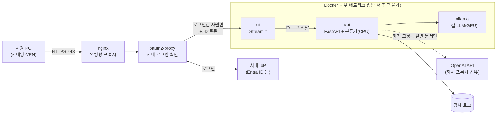

# 사내망 배포 설계 (Docker + 사내 로그인)

> 상태: **설계 단계**. 아직 구현하지 않았다. 이 문서의 구조와 결정을 확인한 뒤 단계별로 구현한다.

## 0. 목적과 범위

지금 서비스는 노트북 한 대에서 API(FastAPI)와 화면(Streamlit)을 띄워 혼자 쓰는 상태다. 이 문서는 같은 서비스를 **사내 GPU 서버에 Docker로 올리고, 사내망에서 사내 계정으로 로그인한 사원만 쓰게 하는** 계획을 정리한다.

정한 운영 정책은 다음과 같다.

| 사용자 | 쓸 수 있는 생성 모델 |
|---|---|
| 로그인하지 않은 사람 | 접속 불가 |
| 일반 사원 | **로컬 모델만** (qwen2.5-7b → qwen3-4b) |
| 허가된 그룹 | 로컬 모델 + 상용 모델(gpt-6-luna) 선택 가능. 단, **기밀 문서는 상용 모델 불가** |

- **기본값은 모든 사용자에게 로컬 모델**이다. 상용 모델은 허가된 사람이 직접 골랐을 때만 쓴다.
- 이 정책에 맞추면 **지금 동작이 하나 바뀐다.** 현재 자동 라우팅은 일반 문서를 잠정 선택 모델(gpt-6-luna)로 먼저 보낸다. 배포판에서는 누구든 자동 라우팅이면 로컬 모델부터 쓴다. 생성 모델 비교 결과(품질 순위)는 보고서에 그대로 두고, 운영 기본값만 비용·보안 정책으로 정한다.
- 누가 언제 어떤 모델을 썼는지 **사원 단위로 추적**할 수 있어야 한다. 단, 로그에는 이메일 대신 **가명 ID**를 남긴다(4장).
- 사원이 기밀 체크를 잊을 수 있으므로, 상용 모델로 보내기 전에 **기밀 여부를 자동으로 한 번 더 판별**한다(5장).

범위 밖: 인터넷 공개, 클라우드 GPU 서버, 여러 서버로 늘리기(수평 확장).

## 1. 용어 (처음 보는 사람을 위해)

| 용어 | 뜻 | 이 프로젝트에서 |
|---|---|---|
| 이미지 | 프로그램과 실행에 필요한 것(파이썬, 라이브러리, 코드)을 하나로 묶은 파일 | `api` 이미지, `ui` 이미지 |
| 컨테이너 | 이미지를 실제로 실행한 것. 서버마다 설치 차이 없이 같은 환경으로 돈다 | api·ui·ollama·로그인·프록시 컨테이너 |
| 볼륨 | 컨테이너 밖(서버 디스크)에 두고 컨테이너에 연결하는 폴더. 컨테이너를 지워도 남는다 | 분류기 가중치, Ollama 모델, 감사 로그 |
| Docker Compose | 여러 컨테이너를 `compose.yaml` 파일 하나로 정의하고 한 번에 띄우는 도구 | `docker compose up -d` |
| 내부 네트워크 | 컨테이너끼리만 통신하는 가상 네트워크. 밖에서는 들어올 수 없다 | api·ollama는 여기에만 둔다 |
| 역방향 프록시 | 외부 요청을 받는 유일한 입구. HTTPS를 처리하고 안쪽 서비스로 넘겨준다 | nginx |
| SSO / OIDC | 회사 계정 하나로 여러 사내 서비스에 로그인하는 방식 / 그 표준 규약 | 사내 계정 시스템(IdP)과 연결 |
| IdP | 사원 계정과 그룹을 관리하는 회사 계정 시스템 | Microsoft Entra ID, Google Workspace, Okta 등. 개발 중에는 Keycloak으로 흉내 |
| 토큰 / 클레임 | 로그인하면 IdP가 발급하는 서명된 신분증 / 그 안에 적힌 항목(이메일, 그룹 등) | `email`, `groups` 클레임으로 권한 판단 |

## 2. 목표 구조



| 컨테이너 | 하는 일 | 외부 포트 | 이미지 |
|---|---|---|---|
| `proxy` | 유일한 입구. HTTPS 인증서 처리 | **443만 사내 IP에 공개** | 공식 nginx |
| `auth` | 로그인 안 한 요청을 IdP 로그인 화면으로 보냄. 로그인한 요청에만 사용자 정보와 토큰을 붙여 넘김 | 없음 | 공식 oauth2-proxy |
| `ui` | Streamlit 화면. API를 호출만 함 | 없음 | 직접 빌드 |
| `api` | 분류 → 정책 → 라우팅 → 생성. **권한 검사와 감사 로그를 여기서** | 없음 | 직접 빌드 |
| `ollama` | 로컬 LLM 실행(GPU) | 없음 | 공식 ollama/ollama |

**사내망에서만 접속되는 이유 (세 겹)**
1. 서버에 공인 IP가 없고 사내 방화벽 안에 있다. 재택근무자는 사내 VPN으로 들어온다.
2. Compose에서 밖으로 여는 포트는 `proxy`의 443 하나이고, 그것도 서버의 사내 IP에만 묶는다.
3. `api`와 `ollama`는 내부 네트워크에만 있어서 사원 PC에서도 직접 호출할 수 없다. 반드시 로그인을 거친 `ui`를 통해야 한다.

## 3. 로그인과 허가된 그룹 인증

### 3.1 원칙

- **그룹은 앱이 아니라 회사 IdP에서 관리한다.** 앱 안에 "허가된 사람 목록"이나 공용 비밀번호를 두지 않는다. 입사·퇴사·부서 이동이 IdP 한 곳에서 반영되고, 누가 그룹에 넣었는지도 IdP에 기록된다.
- IT 관리자가 IdP에 그룹(예: `doc-summarizer-cloud`)을 만들고 허가된 사원을 넣는다. Entra ID라면 "앱 역할(app role)"로 만들어도 된다.
- 사원이 로그인하면 IdP가 **서명된 ID 토큰**을 발급하고, 그 안의 `groups`(또는 `roles`) 클레임에 소속 그룹이 적힌다.

### 3.2 흐름

1. 사원이 `https://doc-summary.사내도메인`에 접속한다.
2. `auth`(oauth2-proxy)가 로그인하지 않은 사원을 회사 로그인 화면으로 보낸다.
3. 로그인하면 `auth`가 ID 토큰을 받아 요청에 붙여 `ui`로 넘긴다.
4. `ui`는 토큰을 그대로 `api` 호출에 붙인다(`Authorization: Bearer <토큰>`). 화면에는 "OOO님" 표시, 허가 그룹이 아니면 모델 목록에서 상용 모델을 숨긴다.
5. `api`가 **토큰 서명을 IdP 공개키로 직접 검증**하고, 이메일과 그룹을 꺼내 권한을 판단한다.

### 3.3 권한 검사는 API에서 한다

화면에서 상용 모델을 숨기는 것은 편의일 뿐이다. 실제 차단은 `api`가 한다. 그래야 화면을 거치지 않은 요청이나 조작된 요청도 막힌다. API가 받은 요청 본문의 "나는 허가 그룹이다" 같은 값은 믿지 않고, **서명이 확인된 토큰의 클레임만** 믿는다.

| 요청 | 일반 사원 | 허가 그룹 |
|---|---|---|
| 자동 라우팅, 일반 문서 | qwen2.5-7b → qwen3-4b | qwen2.5-7b → qwen3-4b (기본은 로컬) |
| 자동 라우팅, 기밀 문서 | qwen2.5-7b → qwen3-4b | qwen2.5-7b → qwen3-4b |
| `target=openai`, 일반 문서 | **403** `cloud_not_permitted` | gpt-6-luna (실패 시 로컬 대체) |
| `target=openai`, 기밀 문서 | **403** `cloud_not_permitted` | **422** `confidential_requires_local` (지금과 같음) |
| 토큰 없음·만료·서명 불일치 | **401** `unauthenticated` | **401** |

### 3.4 개발 중에는

혼자 하는 프로젝트라 실제 회사 IdP가 없다. 그래서 **Keycloak**(무료 오픈소스 IdP)을 컨테이너로 하나 더 띄워 회사 IdP를 흉내 낸다. 테스트 사용자 두 명(일반 사원, 허가 그룹)을 만들어 위 표를 그대로 시험한다. 실제 회사에 붙일 때는 IdP 주소와 클라이언트 ID·비밀값만 바꾸면 된다(OIDC가 표준이라 코드는 같다).

노트북에서 지금처럼 로그인 없이 개발할 수 있도록 `AUTH_MODE=off|oidc` 설정을 둔다. `off`면 지금과 같이 동작하고(로컬 개발 전용), 배포판 Compose 파일은 `oidc`로 고정한다.

## 4. 감사 로그 (사원 추적)

`api`가 요청마다 한 줄씩 JSONL로 남긴다. 볼륨(`/data/audit`)에 저장해 컨테이너를 다시 만들어도 남게 한다.

| 남기는 항목 | 예 |
|---|---|
| 시각, 요청 ID | `2026-10-20T10:12:03+09:00`, `req-…` |
| 사원 | **가명 ID**(예: `u_7f3a9c…`), 소속 그룹·부서 |
| 요청 | 기밀 체크 여부, 자동 판별 결과와 이유(규칙 이름 등), 지정 모델/자동, 글자 수 |
| 결과 | 분류 유형·확신도, 실제 사용 모델, 대체 경로 사용 여부, 상태 코드·오류 코드 |
| 비용 | 상용 모델 토큰 수와 비용 |

- **문서 원문과 요약 내용은 남기지 않는다.** 로그가 기밀 문서의 사본이 되기 때문이다.
- 거부된 요청(401·403·422)도 남긴다. 권한 없는 상용 모델 시도를 찾을 수 있어야 한다.
- 보관 기간과 열람 권한은 회사 규정을 따른다(예: 1년, 관리자 그룹만 열람).
- 나중에 가명 ID·부서별 상용 모델 사용량과 비용을 이 로그로 집계할 수 있다.

### 4.1 가명 ID

- 가명 ID = `HMAC-SHA256(비밀키, 이메일)`의 앞부분. 같은 사원은 늘 같은 값이라 사용량 집계는 되지만, 로그만 봐서는 누군지 알 수 없다.
- **비밀키 없이 이메일만 해시하지 않는다.** 사원 이메일 목록은 사내에 알려져 있어서, 목록을 하나씩 해시해 대조하면 바로 되돌릴 수 있다.
- 비밀키는 서버 비밀값(`AUDIT_PSEUDONYM_KEY`)으로만 두고, 로그 열람 권한과 **분리해서** 보안 담당자가 보관한다. 사고 조사처럼 필요할 때만 "이 사원의 가명 ID"를 계산해 대조한다.
- 부서·그룹은 그대로 남긴다(부서별 집계용). 가명 처리한 정보도 법적으로는 개인정보이므로 보관 기간·열람 권한 규정은 그대로 적용한다.
- 비밀키를 바꾸면 이전 로그와 가명 ID가 이어지지 않는다. 바꿀 때는 날짜를 기록해 둔다.

## 5. 기밀 여부 자동 판별

사원이 기밀 체크를 잊어도 기밀 문서가 밖으로 나가지 않게 한다.

### 5.1 언제 판별하나

정책상 일반 사원은 상용 모델을 쓸 수 없으므로 체크를 잊어도 외부로 나가지 않는다. 위험한 경우는 **허가 그룹이 상용 모델을 고른 일반 문서 요청** 하나뿐이다. 그래서 그 요청에만 판별을 돌린다(나머지는 어차피 로컬).

### 5.2 세 겹, 하나라도 기밀이면 기밀

| 겹 | 방법 | 잡는 것 | 비고 |
|---|---|---|---|
| 0 | 문서 보안 등급 정보 | 문서 관리 시스템·DRM에 이미 붙은 "대외비" 등 등급 | 실제 회사에서 가장 확실한 출처. 이 프로젝트에서는 API에 `security_label` 입력 칸만 만든다 |
| 1 | 규칙 | "대외비·기밀·Confidential" 표시, 주민등록번호·계좌·카드번호 형식, 급여·인사평가 등 단어 | 빠르고 이유를 정확히 보여 줌. 규칙 목록은 설정 파일로 관리 |
| 2 | 로컬 LLM 판별 | 표시는 없지만 문맥상 민감한 내용(미공개 실적, 협상 조건 등) | 로컬 모델(qwen3-4b)로 판단하므로 문서가 밖으로 나가지 않음. 1~2초 추가 |

- **올리기만 하고 내리지 않는다.** 사원이 기밀로 체크한 문서를 시스템이 일반으로 바꾸지 않는다.
- **애매하면 기밀.** 놓치는 것(기밀이 외부로 나감)이 지나치게 잡는 것(로컬로 처리)보다 훨씬 위험하다. 로컬 LLM이 응답하지 않거나 판별에 실패해도 기밀로 본다.
- 기밀로 판정되면 상용 모델 대신 로컬 모델로 처리하고, 응답과 화면에 이유를 보여 준다(예: "주민등록번호 형식이 있어 로컬 모델로 처리했습니다"). 감사 로그에도 판정 이유를 남긴다.

### 5.3 분류기 학습을 지금 쓰지 않는 이유

- 학습하려면 실제 기밀 문서를 모아 정답을 달아야 하는데, 기밀 문서를 한곳에 모으는 일 자체가 위험하다. 감사 로그에 원문을 남기지 않으므로 운영 중에 모을 수도 없다.
- 기밀의 기준이 회사마다 다르고 자주 바뀐다(새 프로젝트명 등). 학습하지 않은 유형은 놓친다.
- 판단 이유를 설명하기 어렵다.
- 회사가 정답이 달린 데이터를 안전하게 제공할 수 있게 되면 세 번째 겹으로 추가한다.

### 5.4 검증과 한계

- 이 프로젝트의 데이터에는 기밀 여부 정답이 없다. 그래서 판별 성능(놓친 비율, 지나치게 잡은 비율)을 제대로 측정할 수 없다.
- 대신 기밀 문장(규칙 대상, 문맥상 민감)과 일반 문장을 직접 만든 소규모 점검 세트로 동작만 확인하고, 이 한계를 보고서에 적는다.
- 판별을 추가하면 상용 모델 요청이 1~2초 느려진다. 이 시간도 측정해 기록한다.

## 6. 동시 사용

### 6.1 규모 감각

qwen2.5-7b는 문서 1건에 약 2초 걸리므로, 한 건씩 처리해도 1시간에 약 1,800건이다. 평소 사용에는 충분할 가능성이 크다. 문제가 되는 경우는 두 가지다: 사람이 몰리는 순간, 그리고 누군가 CSV 수백 건으로 GPU를 오래 차지하는 경우.

### 6.2 대응

| 방법 | 효과 | 적용 |
|---|---|---|
| 줄 세우기 + 대기 표시 | 실패하지 않고 순서대로 처리, 화면에 대기 건수 표시 | 구현 |
| CSV 일괄 처리를 별도 작업 큐로 | 한 건 요청이 먼저. 일괄 처리는 뒤에서 진행, 끝나면 결과 내려받기 | 구현 |
| 사원당 요청 제한 | 한 사람이 GPU를 독점하지 못하게 | 구현 |
| 같은 문서 결과 재사용 | 같은 공지를 여러 명이 요약하면 한 번만 생성. 원문 대신 해시를 키로 짧게 보관 | 선택 |
| Ollama 동시 처리(`OLLAMA_NUM_PARALLEL`) | 여러 건을 같이 처리. 문맥 메모리가 추가로 들어 8GB에서는 2건 정도 예상 | 측정 후 결정 |
| 더 큰 GPU / 전용 서빙 엔진(vLLM) | 동시 처리 수가 크게 늘어남 | 회사 서버에서 |

### 6.3 측정 계획

노트북에서 동시 요청 1·2·4·8건일 때 응답 시간(평균·최대)과 GPU 메모리를 측정해 기록한다. 회사 서버 GPU는 더 클 것으로 예상되므로, 이 결과를 "사원 몇 명까지 이 장비로 충분한지, 서버에 어느 정도 GPU가 필요한지"를 정하는 근거로 쓴다.

## 7. 분류기 가중치와 모델 파일

### 7.1 추천: 서버 폴더에 두고 읽기 전용 볼륨으로 연결 + 해시 확인

```
서버: /srv/doc-summarizer/models/classifier/   ← 노트북의 checkpoint 폴더(423MB)를 한 번 복사
      /srv/doc-summarizer/models/classifier.sha256
컨테이너 api: /models/classifier (읽기 전용으로 연결)
```

- `api`는 시작할 때 가중치 파일의 SHA-256 해시를 계산해 `selection/selected.json`에 기록해 둔 값과 비교한다. 다르면 시작하지 않는다. 엉뚱한 가중치로 서비스가 도는 일을 막고, "보고서의 그 모델"로 돈다는 근거가 된다.
- 노트북 → 서버 복사는 처음 한 번(`scp`나 사내 파일 공유).

**이렇게 고른 이유**

| 방법 | 장점 | 단점 | 판단 |
|---|---|---|---|
| **서버 폴더 + 읽기 전용 볼륨** | 이미지가 작고 빌드가 빠름. 가중치를 바꿔도 이미지를 다시 만들 필요 없음. 인터넷 불필요 | 서버에 파일을 한 번 옮겨야 함 | **추천** |
| 이미지 안에 넣기 | 이미지 하나에 코드와 가중치가 함께 묶여 버전 관리가 단순 | 코드 한 줄만 고쳐도 423MB를 다시 빌드·전송. 사내 이미지 저장소가 필요 | 차선 |
| Hugging Face Hub에서 받기 | 어디서든 한 줄로 받음 | 서버가 인터넷에 나가야 함. 사내 모델을 외부 저장소에 둠(비공개라도) | 온프레미스 방향과 맞지 않음 |
| 컨테이너에서 재학습 | 가중치를 옮길 필요 없음(GPU로 26초) | 하드웨어가 다르면 결과가 미세하게 달라 보고서 수치와 어긋날 수 있음. 학습 데이터가 서버에 있어야 함 | 비상용 |

### 7.2 Ollama 모델

같은 방식으로 Ollama 모델 폴더를 볼륨(`/srv/doc-summarizer/ollama`)으로 둔다. 서버에 처음 설치할 때 `qwen2.5:7b`, `qwen3:4b-instruct-2507-q4_K_M` 두 개만 받아 둔다(약 7.5GB). 그 뒤로 `ollama` 컨테이너는 **인터넷이 없는 내부 네트워크**에서만 돈다.

## 8. 네트워크와 비밀값

- **내부 네트워크 두 개**
  - `backend`(인터넷 차단, Compose의 `internal: true`): `ui`·`api`·`ollama`. 기밀 문서가 지나는 길이 아예 밖으로 나갈 수 없다.
  - `egress`: `api`만 추가로 연결. OpenAI 호출용이며, 가능하면 회사 프록시를 거쳐 `api.openai.com`만 허용한다.
- **비밀값**(OpenAI 키, OIDC 클라이언트 비밀값, 쿠키 암호화 키)은 이미지에 넣지 않는다. 서버의 `.env` 파일(관리자만 읽기 가능) 또는 Docker secret으로 주입한다. git에는 `deploy/.env.example`(값 없는 견본)만 올린다.
- HTTPS 인증서는 회사 인증 기관(CA)에서 발급받아 `proxy`에 넣는다.

## 9. 만들 파일과 바꿀 코드 (계획)

**새로 만들 파일**

```
deploy/
  compose.yaml            # 컨테이너 5개(+ 개발용 keycloak), 네트워크, 볼륨, GPU 설정
  compose.dev.yaml        # 노트북 시험용: keycloak 추가, 자체 서명 인증서
  Dockerfile.api          # 파이썬 3.12 + uv, CPU용 torch(이미지 크기 절약), steps/ 코드
  Dockerfile.ui           # 파이썬 3.12 + streamlit, app/ 코드
  nginx.conf              # 443 → auth → ui
  oauth2-proxy.cfg        # IdP 주소, 허용 도메인, 토큰 전달 설정
  .env.example            # 필요한 비밀값 이름만
  README.md               # 설치·실행·점검 순서
```

- `api` 이미지는 분류기를 CPU로만 돌리므로 **CPU용 torch**를 쓴다. 지금 프로젝트는 학습용 CUDA torch를 쓰는데, 그대로 넣으면 이미지가 수 GB 커진다.

**바꿀 코드**

| 위치 | 변경 |
|---|---|
| `steps/lesson_settings.py` | `AUTH_MODE`, `CLOUD_ALLOWED_GROUPS`, `OIDC_ISSUER`, `OIDC_AUDIENCE`, `AUDIT_LOG_DIR`, `AUDIT_PSEUDONYM_KEY`(비밀값), `CONFIDENTIAL_RULES`, `CLASSIFIER_DIR`(볼륨 경로), 동시 처리·요청 제한 설정 |
| `steps/common/auth.py` (새 파일) | 토큰 검증 → `User(email, groups, can_use_cloud)` |
| `steps/common/audit.py` (새 파일) | 감사 로그 한 줄 기록, 가명 ID 계산 |
| `steps/common/confidential.py` (새 파일) | 기밀 판별: 보안 등급 → 규칙 → 로컬 LLM, 판정과 이유 반환 |
| `steps/step08_connect_chain.py` | `routing_plans`가 사용자 권한을 받도록. 자동 라우팅 기본은 모두 로컬 |
| `steps/step10_serve_api.py` | `/classify`·`/summarize`·`/compare`에 사용자 확인(401/403), 상용 모델 요청 전 기밀 판별, 감사 로그, 요청 제한, 시작 시 가중치 해시 확인. CSV 일괄 처리용 작업 큐 엔드포인트 |
| `steps/step06_predict.py` | 가중치 경로를 설정(`CLASSIFIER_DIR`)으로 바꿀 수 있게 |
| `app/streamlit_app.py` | 받은 토큰을 API 호출에 전달, 사용자 이름 표시, 권한 없으면 상용 모델 숨김, 기밀 자동 판정 이유 표시, 대기 건수·일괄 작업 진행 표시 |
| `scripts/api_examples.py` | 권한 시나리오(일반 사원 상용 시도 403, 토큰 없음 401 등), 기밀 자동 판별 시나리오 추가 |
| `scripts/measure_concurrency.py` (새 파일) | 동시 요청 1·2·4·8건 응답 시간·GPU 메모리 측정 |

## 10. 구현 단계

한 번에 다 하지 않고, 단계마다 동작을 확인한 뒤 넘어간다.

| 단계 | 내용 | 확인 방법 |
|---|---|---|
| 1 | **노트북에서 Docker Desktop으로** `api`·`ui`·`ollama` 세 개만, 로그인 없이(`AUTH_MODE=off`) 띄우기 | 화면에서 요약 1건, CSV 15건 일괄 처리가 지금과 같은 결과 |
| 2 | 권한 정책 코드 + 감사 로그(가명 ID) + 기밀 자동 판별. 개발용 가짜 사용자로 시험 | 3.3절 표의 모든 칸과 기밀 점검 세트를 `api_examples.py`로 실행·저장. 로그에 이메일이 없는지 확인 |
| 2-1 | 동시 사용: 줄 세우기, CSV 작업 큐, 요청 제한, 동시 요청 측정 | `measure_concurrency.py` 결과를 표로 기록 |
| 3 | Keycloak + oauth2-proxy + nginx 추가, 실제 로그인 흐름 | 두 테스트 사용자로 화면 로그인 → 모델 목록·차단·로그 확인 |
| 4 | 가중치 해시 확인, 인터넷 차단 네트워크 | 해시를 일부러 틀리게 해 시작 거부 확인, `ollama` 컨테이너에서 외부 접속 실패 확인 |
| 5 | 사내 서버 이전 체크리스트 작성 | 서버 요구 사항(GPU 드라이버, NVIDIA Container Toolkit, 디스크), IdP 등록 정보, 인증서 |

- 노트북(Windows)에서는 Docker Desktop이 WSL2를 통해 GPU를 쓸 수 있다. 1단계에서 이것부터 확인한다.
- 실제 사내 서버는 보통 Linux이고, 같은 `compose.yaml`이 그대로 동작한다(Docker를 쓰는 이유).

## 11. 위험과 열린 질문

| 항목 | 내용 | 대응 |
|---|---|---|
| 동시 사용 | 노트북 GPU(8GB)에서는 동시에 2건 정도만 처리한다 | 6장의 줄 세우기·작업 큐·요청 제한. 동시 요청 측정 결과로 회사 서버에 필요한 GPU를 판단 |
| 실제 IdP 없음 | 회사 IdP 연결은 시험하지 못한다 | Keycloak으로 표준(OIDC) 흐름만 검증하고 한계로 적음 |
| 감사 로그의 개인정보 | 가명 ID도 비밀키가 있으면 사원과 대조된다 | 비밀키를 로그 열람 권한과 분리해 보관, 보관 기간·열람 권한 명시(4.1) |
| 기밀 판별 누락 | 규칙과 로컬 LLM 모두 놓치는 기밀 문서가 있을 수 있다. 판별 성능을 측정할 정답 데이터가 없다 | 세 겹 판별 + 애매하면 기밀(5장). 허가 그룹이 상용 모델을 고를 때 확인 문구. 점검 세트 결과와 한계를 보고서에 기록 |
| 컨테이너 이미지 크기 | torch 때문에 수백 MB~수 GB | CPU용 torch, 불필요한 학습 라이브러리 제외 |
