# 모델 선정 보고서: 문서 분류 + 유형별 요약 서비스

> 작성 중인 보고서입니다. 그림과 표는 `uv run python scripts/build_report.py`로 다시 만들 수 있습니다.
>
> ⚠ **사람 채점은 1명이 36건(모델당 12건)을 마쳤고, 생성 모델 선택은 아직 확정하지 않았습니다.** 선택은 LLM 채점 기준의 **잠정** 결과입니다. 사람 채점이 LLM 채점과 크게 달랐고(사용 가능 판정 kappa 0.35) 표본이 작아, 사람 판정으로는 로컬 모델(qwen2.5-7b)이 선택 규칙을 통과하지만 그 차이가 12건 중 1건 수준입니다(5.4장). 2~4번 시트는 실제 채점이 아니라 가상 데이터입니다.

| 장 | 상태 |
|---|---|
| 1. 문제 정의 | 작성 |
| 2. 데이터 | 작성 |
| 3. 분류 모델 비교와 선정 | 작성 (validation 기준) |
| 4. 분류 모델 최종 평가 (test) | 작성 (기본·심화 각 1회) |
| 5. 생성 모델 비교 (로컬 vs 상용) | 작성 (사람 1명 채점 반영, 선택은 잠정) |
| 6. 서비스 구성 (LangChain + FastAPI) | 작성 |
| 7. 긴 문서 실험 (심화 데이터, 선택 과제) | 작성 (심화 test 결과는 4.2장) |
| 8. 최종 선정과 한계 | 잠정 작성 |
| 9. 팀원 역할과 기여 | 예정 |

---

## 1. 문제 정의

- **대상**: 사내 공지, 매뉴얼, 회의록을 읽고 핵심을 빠르게 파악해야 하는 구성원
- **입력**: 문서 원문 한 건
- **출력**: 문서 유형(분류 결과)과 유형에 맞는 요약
- **처리 흐름**: 학습한 분류기가 유형을 예측 → 예측 유형에 맞는 요약 정책 선택 → 생성 LLM이 원문과 정책으로 요약
- **팀 방향: 비용 최적화와 온프레미스**
  - 사내 문서는 외부로 보내기 어려운 내용이 많다.
  - 문서가 길수록 상용 API의 토큰 비용이 커진다.
  - 그래서 로컬 LLM(Ollama)과 상용 API를 품질, 시간, 비용, 운영 조건으로 실측 비교해 근거를 만든다.

## 2. 데이터

| 분할 | 행 수 | 용도 |
|---|---|---|
| train | 360 (라벨별 120) | 분류 모델 학습 |
| validation | 120 (라벨별 40) | 분류 모델 비교·선정 |
| test | 120 (라벨별 40) | 분류 최종 평가 |
| generation_development | 15 | 생성 흐름 개발 |
| generation_eval | 24 | 생성 모델 최종 비교 |

- 출처: 제공된 교육용 합성 데이터(`original-synthetic:synthetic-ko-v2.0`). 정해진 분할을 그대로 쓴다.
- 분할 사이에 같은 문장이나 같은 `group_id`가 겹치지 않는 것을 확인했다(step02).
- 생성 데이터의 `expected_label`, `required_points`, `forbidden_claims`는 채점에만 쓰고 모델 입력에는 넣지 않는다.
- 선택 과제용 심화 데이터 `documents_advanced`(평균 약 900자)는 별도로 실험한다.

## 3. 분류 모델 비교와 선정

상세 기록: [문서 분류 모델 실험 기록](experiment_log_classification.md) · 전체 표: [분류 실험 표](generated/classification_tables.md)

### 3.1 후보와 비교 조건

| 모델 | ID | 파라미터 | 출처·사용 조건 | 후보 선정 이유 |
|---|---|---|---|---|
| 기준 모델 | TF-IDF(문자 2~5gram) + 로지스틱 회귀 | 0.12M | scikit-learn (BSD-3) | 필수 기준선 |
| bert | klue/bert-base | 110.6M | Hugging Face, CC-BY-SA-4.0 | 필수 후보, 한국어 KLUE |
| roberta | klue/roberta-base | 110.6M | Hugging Face, 모델 카드에 라이선스 표기 없음 (확인 필요) | 같은 KLUE 계열의 RoBERTa 학습 방식 |
| electra-s | monologg/koelectra-small-v3-discriminator | 14.1M | Hugging Face, 모델 카드에 라이선스 표기 없음 (확인 필요) | 작은 모델의 정확도·자원 절충 확인 |
| electra-b | monologg/koelectra-base-v3-discriminator | 112.9M | Hugging Face, Apache-2.0 | 다른 사전학습 방식(ELECTRA) |
| deberta-ko | team-lucid/deberta-v3-base-korean | 135.3M | Hugging Face, Apache-2.0 | 최신 구조(DeBERTa-v3)의 한국어 모델 |

> 라이선스는 2026-10-11 Hugging Face 모델 카드 메타데이터 기준이다. 표기가 없는 모델은 원 저장소(KLUE, KoELECTRA GitHub)의 라이선스를 제출 전에 확인할 것.

- 모든 사전학습 모델: 전체 파인튜닝, max_length 192, 유효 배치 16, AdamW, BF16, 5 epoch, 학습률 {1e-5, 2e-5, 5e-5}
- 지표: validation Accuracy, Macro-F1(주 지표), 학습 시간, peak VRAM, CPU 1건 추론 시간
- seed 영향을 보려고 상위 설정은 seed 42/43/44로 반복했다.
- 실험 횟수: 기준 모델 1회 + 사전학습 29회

### 3.2 결과 한눈에 보기

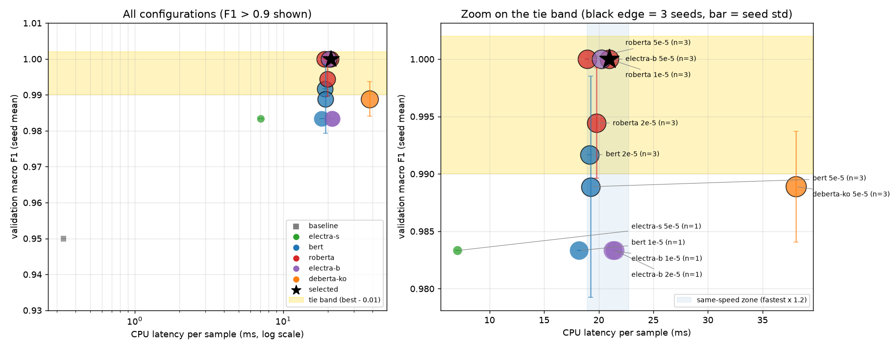

- 왼쪽은 모든 설정, 오른쪽은 노란 동점 범위를 확대한 것이다.
- 기준 모델(회색 네모)은 가장 빠르지만(0.3ms) Macro-F1 0.95로 동점 범위 밖이다.
- 상위 설정들은 모두 19~21ms에 모여 있다. 이 구간에서는 속도로 우열이 갈리지 않고, seed 평균 F1과 안정성이 기준이 된다.
- 검은 별이 선정한 설정(roberta, lr 1e-5)이다.

| 모델 | 최고 설정 lr | seed 수 | val Macro-F1 평균 | 학습 시간 | peak VRAM | CPU 1건 추론 |
|---|---|---|---|---|---|---|
| 기준 모델 | – | 1 | 0.950 | 0.18초 | – | 0.3ms |
| electra-s | 5e-5 | 1 | 0.983 | 25.7초 | 292MB | 7.1ms |
| bert | 2e-5 | 3 | 0.992 ± 0.000 | 24.0초 | 2,131MB | 19.1ms |
| **roberta** | **1e-5** | **3** | **1.000 ± 0.000** | 25.9초 | 2,132MB | 20.9ms |
| electra-b | 5e-5 | 3 | 1.000 ± 0.000 | 30.3초 | 2,174MB | 20.2ms |
| deberta-ko | 5e-5 | 3 | 0.989 ± 0.005 | 48.5초 | 2,610MB | 38.1ms |

### 3.3 학습률과 seed의 영향

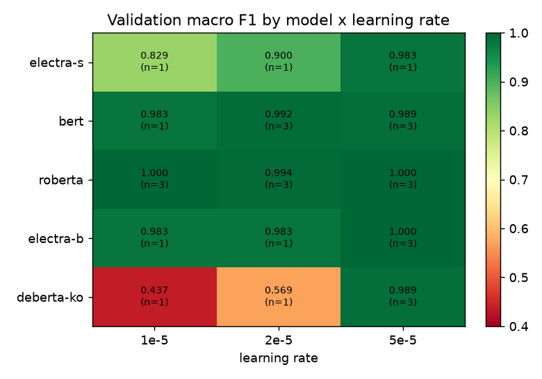

- bert, roberta, electra-b는 세 학습률 모두 0.98 이상으로 안정적이다.
- electra-s와 deberta-ko는 학습률이 낮으면 5 epoch 안에 수렴하지 못한다(deberta-ko 1e-5: 0.437).

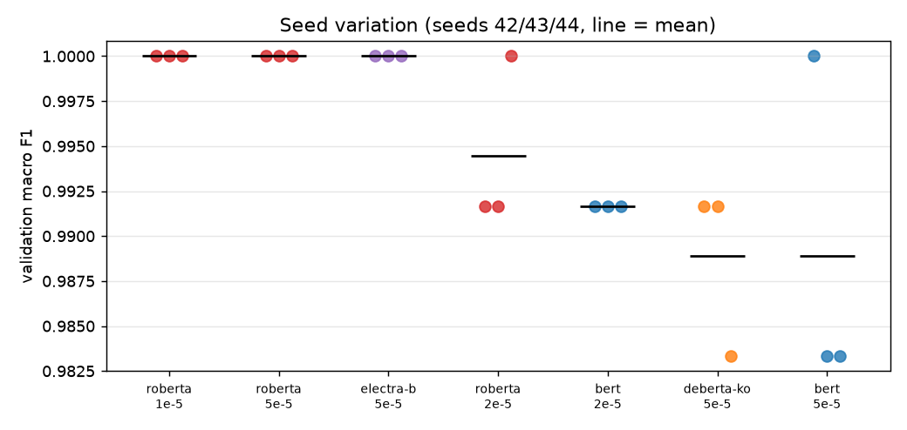

- roberta 1e-5·5e-5, electra-b 5e-5는 seed 3개 모두 1.000이다.
- bert 5e-5는 seed 42에서 1.000이었지만 다른 seed에서 0.983으로, seed 하나의 결과만으로 고르면 안 된다는 것을 보여 준다.

### 3.4 학습 곡선

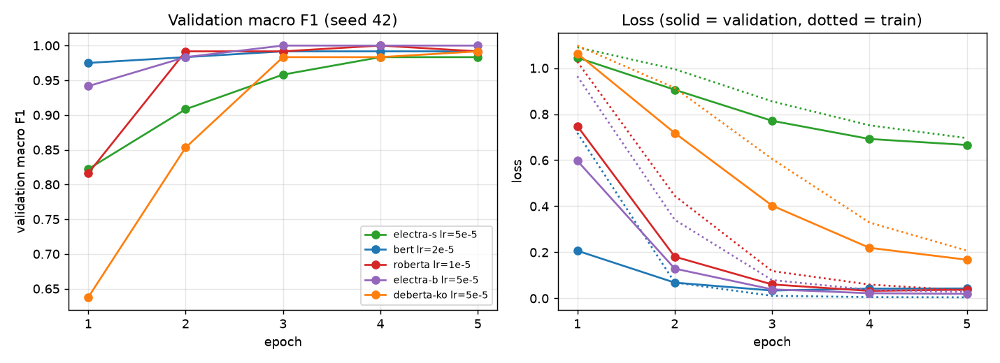

- 모델별 최고 설정의 seed 42 실행이다.
- bert, roberta, electra-b는 2~3 epoch에 수렴한다.
- deberta-ko는 5 epoch까지 validation loss가 계속 내려가 더 학습할 여지가 있다.
- electra-s는 validation loss가 0.66으로 높지만 정확도는 0.98이다. 예측의 확신도가 낮은 상태다.

### 3.5 자원 비교

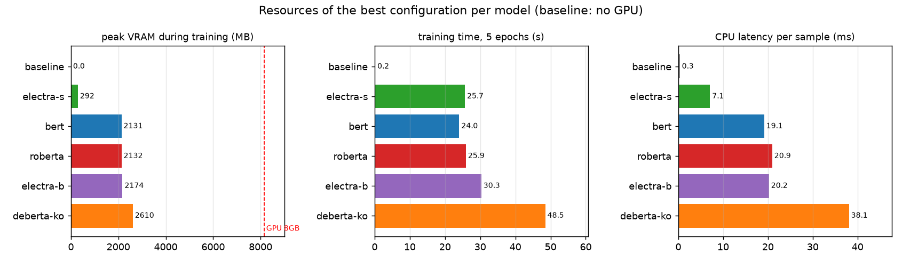

- 모든 후보가 8GB GPU에서 여유 있게 학습된다(최대 2.6GB).
- electra-s는 VRAM 292MB, CPU 추론 7ms로 가장 가볍다.
- deberta-ko는 학습 시간과 추론 시간이 다른 base 모델의 약 2배다.

### 3.6 선정 규칙과 결과

선정 규칙:
1. seed만 다른 실행을 한 설정으로 묶어 validation Macro-F1 평균을 구한다.
2. 평균 최고점에서 0.01(validation 약 1건) 이내는 동점으로 본다.
3. 동점 후보는 모두 seed 3개 이상이어야 한다.
4. CPU 추론 시간이 가장 빠른 후보의 1.2배 이내는 같은 속도로 본다.
5. 평균 Macro-F1 → 표준편차 → 파라미터 수 순으로 고른다.

**선정 결과: klue/roberta-base (lr 1e-5)**
- 동점 범위의 5개 설정이 모두 같은 속도 구간(18.9~20.9ms)에 들어왔다.
- 그중 평균 1.000이 roberta 1e-5, roberta 5e-5, electra-b 5e-5였고, 세 설정 모두 표준편차가 0이었다.
- 파라미터가 더 적은 roberta가 남았다. 두 학습률은 모든 기준에서 같아, 정해 둔 마지막 기준(설정 이름 순)으로 1e-5를 골랐다.
- 서비스에는 seed 42의 가중치를 쓴다.

| 선정 모델 (validation) | 기준 모델 (validation) |
|---|---|
| 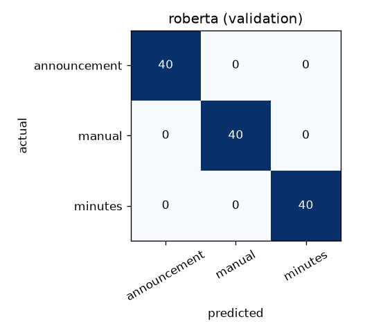 | 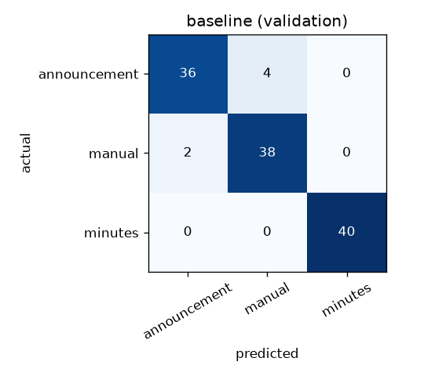 |

- 기준 모델의 오류 6건은 모두 공지↔매뉴얼 사이에서 났다. 공지 안에 이용 방법("확인한다", "싣지 않는다")이 섞인 문장이 매뉴얼로 분류됐다.
- 회의록은 모든 모델이 한 번도 틀리지 않았다.

### 3.7 분류 단계의 한계

- validation이 120건이고 상위 4개 설정이 1.000으로 포화되어, 상위 모델 사이의 우열은 validation으로 가릴 수 없다.
- 학습률과 epoch는 모든 모델에 같은 조건으로 고정했다. electra-s와 deberta-ko는 더 높은 학습률이나 더 긴 학습에서 결과가 달라질 수 있다.
- CPU 추론 시간은 노트북 한 대에서 측정했고 실행마다 약 ±15% 흔들린다.
- 합성 데이터라 실제 사내 문서보다 짧고 정형적이다.

## 4. 분류 모델 최종 평가 (test)

validation으로 선정한 분류기와 전처리를 고정한 뒤 `step11_evaluate_final.py`로 한 번씩 평가했다(2026-10-13). 기준 모델은 함께 보고하기로 미리 정한 `baseline_char2-5`다. 이 결과를 보고 모델이나 설정을 다시 고르지 않는다(step05 재선정은 막힘).

### 4.1 기본 test (120건)

| 모델 | Accuracy | Macro-F1 | CPU 1건 추론 | 오답 |
|---|---|---|---|---|
| **klue/roberta-base (선정)** | **0.983** | **0.983** | 18.3ms | 2건: 매뉴얼 → 공지 |
| TF-IDF + 로지스틱 회귀 (기준) | 0.967 | 0.967 | 0.5ms | 4건: 공지 → 매뉴얼 |

- validation(1.000)보다 2건 더 틀렸다. 선정 분류기가 기준 모델보다 2건 더 맞혔다.
- 선정 분류기의 오답 2건은 같은 상황("재료 요청 철회")을 쓴 두 문서다. 하나는 "~한다", 하나는 제목과 "~합니다"체인데, 둘 다 "필요 없어지면 … 확인한다 / 철회 요청을 남긴다"처럼 대상자에게 알리는 문장이라 공지로 판단했다(확신도 0.95, 0.75).
- 혼동행렬: `artifacts/documents/selection/confusion_test_selected.png`, 사례: `test_case_review.csv`, `test_errors.csv`

### 4.2 심화 test (60건, 본문 추출)

7장에서 test 전에 고정한 결정(선정 분류기를 재학습 없이 쓰고 참고 자료를 뗀 본문만 입력)으로 평가했다(`--track advanced`).

| 모델 | Accuracy | Macro-F1 | 192토큰 잘림 | 오답 |
|---|---|---|---|---|
| klue/roberta-base (선정) + 본문 | 0.883 | 0.882 | 10건 | 7건: 매뉴얼 → 공지 5, 공지 → 회의록 2 |
| TF-IDF + 로지스틱 회귀 (기준) + 본문 | **0.900** | **0.901** | – | 6건 |

| 구조 | 선정 분류기 정답 |
|---|---|
| 참고 먼저 | 27 / 30 |
| 본문 먼저 | 10 / 12 |
| 짧은 문서 | 16 / 18 |

- validation(0.917)보다 2건 낮고, 이번에는 기준 모델이 1건 더 맞혔다. 60건에서 1건은 1.7%p라 두 모델의 차이는 구분할 수 없다.
- 오답 유형은 validation 분석과 같다. 매뉴얼이 배경 설명("지난 …")으로 시작하거나 시각·조건이 적힌 절차라 공지로 읽혔고, 공지가 "검토했습니다 … 하기로 했고"처럼 회의 결과를 전하는 문장으로 시작해 회의록으로 읽혔다. 오답 7건 중 2건은 본문이 192토큰을 넘어 잘렸다.
- 해석: 본문 추출로 긴 문서도 서비스에 쓸 수 있는 수준(원문 그대로였다면 validation 기준 0.567)이 되지만, 짧은 문서로만 학습한 분류기는 긴 문서 본문의 스타일(배경 설명, 긴 절차)에 약하다. 개선하려면 긴 문서 스타일의 학습 데이터와 더 긴 입력이 필요하고, 비교에는 교차 검증이 필요하다(7.2장).
- 혼동행렬·사례: `artifacts/documents_advanced/selection/`

## 5. 생성 모델 비교 (로컬 vs 상용)

평가 기준: [요약 평가 기준](evaluation_rubric.md) · 상세 기록: [생성 모델 실험 기록](experiment_log_generation.md) · 전체 표: [생성 비교 표](generated/generation_tables.md)

### 5.1 후보와 비교 조건

| 구분 | 모델 | 크기(양자화) | 실행 |
|---|---|---|---|
| 로컬 | qwen3:4b-instruct-2507, gemma3:4b, qwen2.5:7b, exaone3.5:7.8b, llama3.1:8b | 2.5~4.9GB (Q4) | Ollama, RTX 5060 Laptop 8GB |
| 상용 | gpt-6-luna | – | OpenAI Responses API (Standard) |

- 같은 분류 결과와 같은 프롬프트를 모든 모델에 준다. 출력은 문서 유형별 JSON이다(공지: 대상·일정·할 일·달라진 점 / 매뉴얼: 사전 준비·절차·주의 / 회의록: 논의·결정·담당·미정 사항).
- 요약은 알림·일정·담당 지정 같은 자동화에 쓰일 수 있는 구조화 데이터로 본다. 그래서 내용뿐 아니라 **각 칸에 맞는 내용이 들어갔는지**도 평가한다.
- 주 지표는 **사용 가능률**이다. 형식 정상, 환각·수치 오류·외국어 없음, 핵심 내용 포함률 0.67 이상, **칸 오류 없음**을 모두 만족한 응답의 비율이다. 칸 오류만 뺀 **읽기용 사용 가능률**을 함께 보고한다.
- temperature 0.2, 최대 출력 512토큰, 구조화 출력(JSON 스키마). 로컬 모델은 준비 호출로 메모리에 올린 뒤 측정한다.
- 모델 라이선스와 사용 조건은 제출 전에 공식 페이지에서 확인해 적는다.

### 5.2 개발 비교: 프롬프트와 칸 규칙 정하기 (development 15건)

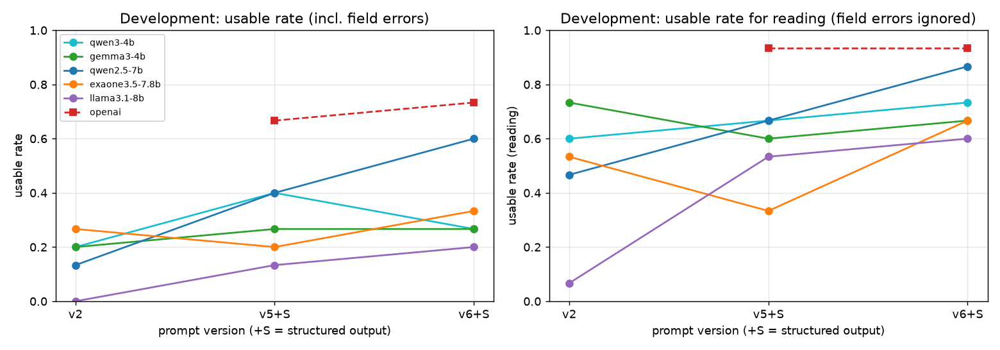

| 버전 | 바꾼 점 | 결과 |
|---|---|---|
| v2 | 라벨별 JSON 형식, 프롬프트로만 형식 요청 | 칸 구분 오류가 많음. gemma3·exaone3.5는 항상 코드 블록으로 감쌌고 llama3.1은 47%가 JSON이 깨짐 |
| v5 | 칸마다 판단 규칙, train 문서로 만든 퓨샷 예시, 정보 없으면 null, 구조화 출력 | 모든 모델의 형식 문제 해결. qwen2.5-7b 사용 가능률 0.13 → 0.40 |
| v6 | 결정을 미룬 회의록 문장은 미정 사항 우선, 맞는 칸이 없는 정보는 summary | qwen2.5-7b 0.60, gpt-6-luna 0.73 |

- 같은 규칙과 예시에서도 칸 오류율이 gpt-6-luna 27%, 소형 모델 40~67%였다. 칸 구분이 소형 모델의 가장 큰 약점이다.
- **최종 비교 후보**: 1위 qwen2.5-7b(0.60). 2위는 사용 가능률 동점 범위(0.10 이내)의 exaone3.5·qwen3·gemma3 중 환각률이 가장 낮은 **qwen3-4b**(환각 1건, exaone3.5는 4건).

### 5.3 최종 비교 (eval 24건 × 2회)

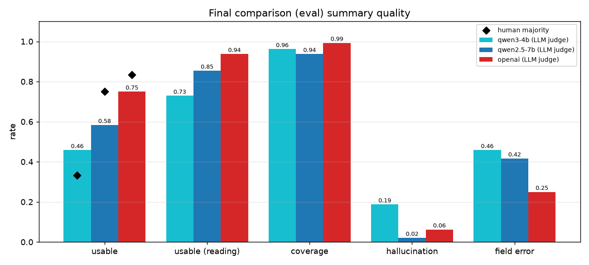

| 모델 | 사용 가능률 | 읽기용 사용 가능률 | 환각률 | 칸 정확도 | 응답 평균 | 응답 p95 | VRAM | 1,000건 API 비용 |
|---|---|---|---|---|---|---|---|---|
| **gpt-6-luna** | **0.750** | **0.938** | 0.062 | **0.920** | 2.57s | 4.74s | – | $0.159 |
| qwen2.5-7b | 0.583 | 0.854 | **0.021** | 0.875 | 2.21s | 3.04s | 4.4GB | $0 |
| qwen3-4b | 0.458 | 0.729 | 0.188 | 0.825 | **1.74s** | **2.33s** | 3.0GB | $0 |

품질은 LLM 채점(144건 전체) 기준이다. 오류와 형식 실패는 세 모델 모두 0건이다.

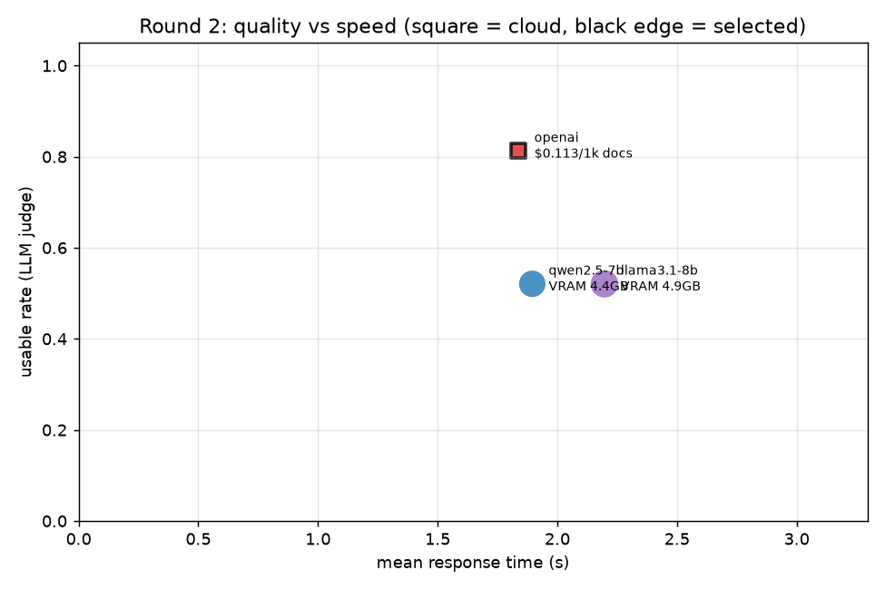

- **품질**: gpt-6-luna가 사용 가능률과 칸 정확도에서 앞선다. 차이는 주로 칸 오류(25% vs 42~46%)에서 나온다.
- **환각**: qwen2.5-7b가 가장 적다(48건 중 1건, gpt-6-luna는 3건).
- **읽기용 기준**: qwen2.5-7b와 gpt-6-luna의 차이는 0.083으로, 사람이 요약을 읽기만 하는 용도라면 품질 하한(0.10) 안에 든다.
- **속도**: 세 모델 모두 평균 2초 안팎이다. gpt-6-luna는 첫 글자까지(TTFT) 1.5초가 걸리고, 로컬 모델은 0.1초 이하로 바로 시작한다.
- **비용**: gpt-6-luna는 이 데이터(퓨샷 포함 입력 약 960토큰)에서 1,000건에 약 $0.16이다. 로컬은 API 비용이 없지만 GPU 장비와 전력, 관리 비용이 든다. 긴 문서의 비용과 손익분기는 7장에서 확인했다.
- **분류 오류의 영향**: 매뉴얼 2건이 공지로 분류되어 공지 형식으로 요약되었다. 세 모델이 같은 입력을 받았으므로 비교의 공정성에는 영향이 없다.

**사람 채점** ⚠ 가상 채점(미리보기용)

**1번 시트는 실제 사람(사용자)이 채점했다.** 2~4번 실제 시트는 비어 있고, 일치도 지표를 살펴보려고 1번을 변형한 가상 3명(가상 채점, 미리보기용)을 따로 만들었다(실험 기록 4.6). 결과와 해석은 5.4장, 전체 표는 [생성 비교 표](generated/generation_tables.md)에 있다.

### 5.4 생성 모델 선택 (잠정)

선택 규칙(평가 기준 8장, 최종 비교 결과를 보기 전에 정함): 로컬 모델의 사용 가능률이 상용보다 0.10 이하로만 낮고 환각률이 0.10 이하로만 높으면 로컬을 우선한다.

| 로컬 모델 | 사용 가능률 차이 (상용 − 로컬) | 환각률 차이 (로컬 − 상용) | 품질 하한 |
|---|---|---|---|
| qwen2.5-7b | +0.167 | −0.042 | 미달 (사용 가능률) |
| qwen3-4b | +0.292 | +0.125 | 미달 |

**잠정 선택: gpt-6-luna** — 두 로컬 모델 모두 사용 가능률(칸 오류 포함)에서 하한에 미달했다(LLM 채점, 모델당 48건). 사람 채점 결과는 아래 5.4.1과 같고, 아직 이 표를 다시 계산해 선택을 확정하지는 않았다.

#### 5.4.1 사람 채점 결과 (실제 1명, 모델당 12건)

표본: 최종 비교 응답 144개 중 반복 1회차에서 모델 × 문서 유형 균등으로 고른 36건이다(모델당 12건). LLM 채점은 144건 전부(모델당 48건)를 했으므로 **서로 다른 표본**이다. 아래는 같은 36건으로 맞춰 비교했다.

| 모델 | 사용 가능 (사람) | 사용 가능 (LLM, 같은 12건) | 환각 (사람) | 환각 (LLM) | 칸 오류 (사람) | 칸 오류 (LLM) |
|---|---|---|---|---|---|---|
| gpt-6-luna | 10 / 12 | 8 / 12 | 1 / 12 | 0 / 12 | 1 / 12 | 4 / 12 |
| qwen2.5-7b | 9 / 12 | 7 / 12 | 1 / 12 | 0 / 12 | 3 / 12 | 5 / 12 |
| qwen3-4b | 4 / 12 | 7 / 12 | 4 / 12 | 2 / 12 | 5 / 12 | 4 / 12 |

**사람과 LLM의 일치도**: 사용 가능 판정 일치율 0.694, Cohen's kappa 0.349, PABAK 0.389. 기준(0.7)에 못 미쳐 평가 기준 7장에 따라 **사람 판정을 우선**한다. 칸 오류 판정이 가장 많이 갈렸고(kappa 0.226) LLM이 칸 판정을 더 엄격하게 봤다(다른 12건 중 8건은 LLM만 칸 오류). 환각은 반대로 사람이 더 많이 찾았다(사람만 4건, LLM만 0건). 계산 방법과 해석은 실험 기록 4.5~4.7장.

**선택 규칙을 적용하면** (select는 아직 실행하지 않음)

| 판정 출처 | 표본 | qwen2.5-7b (사용 가능률 차이 / 환각률 차이) | 결과 |
|---|---|---|---|
| LLM 채점 전체 | 모델당 48건 | +0.167 / −0.042 | 미달 → gpt-6-luna |
| LLM 채점, 같은 36건 | 모델당 12건 | +0.083 / 0.000 | 통과 |
| 사람 채점 | 모델당 12건 | +0.083 / 0.000 | 통과 |

- 사람 판정으로는 qwen2.5-7b가 하한을 통과해 로컬 모델이 선택될 수 있다.
- 다만 **원인은 사람이 다르게 봐서가 아니라 표본이 48건에서 12건으로 줄어서다.** 같은 36건을 LLM이 채점해도 같은 값이 나온다.
- 통과한 차이(0.083)는 12건 중 **1건**이다. 판정 하나가 바뀌면 미달이므로 이 결과로 선택을 확정하기는 어렵다. 채점자가 1명이고 사람-LLM 일치도가 낮다는 점도 한계다.

**⚠ 가상 채점(미리보기용)**: 일치도 지표를 살펴보려고 1번 시트를 변형해 만든 가상 2~4번 시트로 계산한 사람 간 일치도(사용 가능 Fleiss' kappa 0.554, PABAK 0.556 등)는 실제 결과가 아니며, 실제 일치도는 서로 다른 사람이 채점해야 구할 수 있다(실험 기록 4.6).

- 팀 방향(온프레미스)과 다른 결과다. 다만 qwen2.5-7b는 환각이 더 적고 읽기용 기준으로는 하한 안에 든다. 외부 전송이 어려운 문서는 **qwen2.5-7b로 요약하고 사람이 확인해 쓰는 방식**, 자동화가 필요한 문서는 상용 모델을 쓰는 하이브리드 운영을 검토할 만하다.

### 5.5 생성 비교의 한계

- **평가 데이터를 한 번 본 뒤 프롬프트를 바꿨다**: 프롬프트 v4로 평가 데이터를 한 번 실행해 결과를 확인한 뒤, 개발 데이터에서 발견한 칸 규칙 문제를 고쳐(v5, v6) 다시 비교했다. 최종 비교 결과에는 이 점의 영향이 있을 수 있다(이전 결과: `20261011-230905_eval_final`).
- **채점 모델의 자기 편향**: gpt-6-luna는 후보이면서 채점 모델이다. 자기 답변을 후하게 봤을 가능성이 있다. 사람 1명 채점(모델당 12건)에서는 gpt-6-luna에 대해 LLM이 오히려 칸 오류를 더 많이 찾았다(LLM만 4건, 사람만 1건). 후하게 봤다는 근거는 보이지 않지만 표본이 작고 채점자가 1명이라 단정할 수 없다.
- **칸 규칙은 팀이 정한 기준이다**: 정답 출력이 없고, 데이터 문서가 이 칸 구조를 염두에 두고 쓰이지 않아 규칙의 경계에 걸리는 문장이 있다.
- **표본 크기**: 개발 15건, 최종 24건 × 2회. 개발 비교에서 1~2건 차이는 실행마다 바뀔 수 있다.
- **짧은 문서**: 기본 데이터는 문서가 약 100자다. 긴 문서의 시간·비용과 손익분기는 7장에서 따로 측정했다.

## 6. 서비스 구성 (LangChain + FastAPI)

요청 예시 전체: [API 요청 예시](generated/api_examples.md) · 메모리 측정: [분류기 + 로컬 LLM 동시 실행](generated/service_memory.md)

### 6.1 처리 흐름

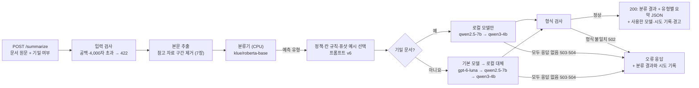

- 분류 → 정책·프롬프트 → 생성이 하나의 LangChain 체인으로 연결된다. 정책 분기는 정답 라벨이 아니라 **분류기의 실제 예측**을 쓴다.
- **본문 추출**(`common.preprocess.extract_body`): 문서에 "이전 운영의 보관 자료"(참고 자료) 구간이 있으면 떼고 이번 본문만 분류·요약한다. 표시가 없으면 원문 그대로다. 응답의 `preprocessing`에 추출 여부와 글자 수를 남기고 경고를 붙인다(7장 근거).
- **하이브리드 라우팅**(`create_routed_chain`): 기밀 문서는 `RunnableBranch`로 로컬 모델 목록에만 보낸다. 일반 문서는 기본 생성 모델(현재 잠정 선택 gpt-6-luna)로 보낸다.
- **대체 경로**(`with_fallbacks`): 생성 모델이 연결 실패·시간 초과면 목록의 다음 모델로 넘긴다. **기밀 문서는 상용 모델로 넘기지 않는다.** 형식 불일치 같은 다른 실패는 넘기지 않고 그대로 알린다.
- 요청에 `target`을 지정하면 그 모델만 쓴다. 기밀 문서를 상용 모델로 지정하면 422(`confidential_requires_local`)로 거부한다.
- 로컬 기본 모델(qwen2.5-7b)은 최종 비교에서 환각이 가장 적고 읽기용 기준으로 품질 하한 안에 든 모델이다. 대체 모델(qwen3-4b)은 두 번째 로컬 후보다.

### 6.2 엔드포인트

| 엔드포인트 | 하는 일 |
|---|---|
| `GET /health` | 서버·분류기 상태, 기본 생성 모델과 선택 상태(잠정/확정), 라우팅 순서, Ollama 연결, API 키 설정 여부 |
| `POST /classify` | 분류만. 생성 모델을 부르지 않음 |
| `POST /summarize` (`/generate`) | 분류 → 정책 → (라우팅) → 생성 → 형식 검사. `confidential`, `target` 선택. 분류 결과, 유형별 요약 JSON, 사용한 모델과 시도 기록, 시간·토큰·비용, 경고를 돌려줌 |
| `POST /compare` | 같은 분류 결과와 프롬프트로 여러 생성 모델 비교 |

### 6.3 정상 요청과 실패 대응 (실제 실행 결과)

| 상황 | 요청 | 상태 | 오류 코드 | 응답 |
|---|---|---|---|---|
| 정상: 분류만 | `/classify` | 200 | – | announcement, 확신도 0.97 |
| 정상: 로컬 모델 지정 | `/summarize` qwen2.5-7b | 200 | – | 회의록 요약 |
| 정상: 일반 문서 자동 | `/summarize` | 200 | – | 기본 모델(gpt-6-luna)로 매뉴얼 요약, "잠정 선택" 경고 |
| 라우팅: 기밀 문서 자동 | `/summarize` 기밀 | 200 | – | qwen2.5-7b로 공지 요약 |
| 라우팅: 기밀 문서를 상용 모델로 지정 | `/summarize` 기밀 + openai | 422 | `confidential_requires_local` | 로컬 모델 목록 안내 |
| 공백만 입력 | `/classify` | 422 | `invalid_request` | text: 공백만 입력할 수 없습니다 |
| 4,000자 초과 | `/summarize` | 422 | `invalid_request` | text: 최대 4,000자 |
| 없는 생성 모델 | `/summarize` | 422 | `invalid_request` | target: 허용된 모델 목록 안내 |
| text 누락 | `/summarize` | 422 | `invalid_request` | text: 필수 |
| Ollama 연결 불가 (모델 지정) | `/summarize` qwen2.5-7b | 503 | `generation_unavailable` | 분류 결과와 시도 기록을 함께 돌려줌 |
| 생성 시간 초과 (모델 지정) | `/summarize` qwen2.5-7b | 504 | `generation_timeout` | 분류 결과와 시도 기록을 함께 돌려줌 |
| 대체 경로: 상용 모델 사용 불가 | `/summarize` | 200 | – | gpt-6-luna 실패 → **qwen2.5-7b로 자동 전환**, 경고 표시 |
| 대체 경로: 기밀 문서, 로컬 모두 불가 | `/summarize` 기밀 | 503 | `generation_unavailable` | qwen2.5-7b → qwen3-4b 모두 실패, 상용 모델로 넘기지 않음 |

실패 상황은 Ollama 주소를 닫힌 포트로 바꾸거나, 시간 제한을 0.001초로 줄이거나, API 키를 잠시 지워 재현했다(`scripts/api_examples.py`). 오류 메시지에는 비밀값이 섞이지 않도록 예외 종류와 줄인 메시지만 담는다.

### 6.4 분류기와 로컬 LLM을 함께 실행할 때의 자원

| 생성 모델 | 분류기 RAM (CPU) | LLM VRAM | GPU 전체 사용량 | 첫 요청(콜드 스타트) | 요청 평균(분류+생성) | 분류·정책 단계 |
|---|---|---|---|---|---|---|
| qwen2.5-7b | 365MB | 4,528MB | 4,770MB / 8,151MB | 4.84s | 2.03s | 45ms |
| qwen3-4b | 365MB | 3,031MB | 3,264MB / 8,151MB | 3.61s | 1.48s | 44ms |

- 분류기는 CPU에서 돌아 GPU를 나눠 쓰지 않는다. 8GB GPU에서 7B 모델까지 여유 있게 함께 실행된다.
- 분류와 정책 선택은 요청당 약 45ms로, 전체 시간의 대부분은 생성 단계다.
- 로컬 모델은 5분간 요청이 없으면 메모리에서 내려가고(keep_alive), 다음 첫 요청에 약 4~5초가 더 걸린다.

### 6.5 사용자 화면 (Streamlit)

`app/streamlit_app.py`는 FastAPI 서버를 호출하는 화면이다.

| 탭 | 기능 |
|---|---|
| 문서 하나 요약 | 문서 입력(예시 문서 불러오기), 기밀 문서 체크, 생성 모델 선택(자동 라우팅 또는 직접 지정). 결과는 문서 유형·확신도·사용 모델·응답 시간과 유형별 칸(대상, 일정, 할 일 등)으로 나눠 보여 준다. 처리 중 표시, 실패 시 오류 코드와 시도한 모델 안내 |
| CSV 일괄 처리 | `text` 열이 있는 CSV 업로드(또는 예시 파일), 진행률 표시, 결과 표(성공 여부·유형·확신도·사용 모델·대체 경로·응답 시간·요약), 결과 CSV 내려받기. 상용 모델을 쓰면 요금 안내 |

- 예시 CSV(`data/demo/batch_sample.csv`)는 생성 개발 데이터 15건의 `id`, `text`만 담았다. 분류 최종 평가에 쓸 test 데이터는 화면에서도 쓰지 않는다.
- 실행 확인: 예시 문서를 기밀로 요약하면 qwen2.5-7b가 쓰였고, 예시 CSV 15건을 기밀(로컬)로 일괄 처리하면 15건 모두 성공, 평균 2.4초였다(Streamlit AppTest로 확인).

## 7. 긴 문서 실험 (심화 데이터, 선택 과제)

상세 기록: [긴 문서 실험 기록](experiment_log_long_documents.md) · 손익분기 표: [손익분기](generated/break_even.md)

### 7.1 심화 데이터의 구조

긴 문서는 **다른 유형의 참고 자료 + 이번 본문**으로 되어 있고, 라벨은 이번 본문의 유형을 따른다.

| 구조 (train 180 / validation 60) | 개수 | 본문 위치 |
|---|---|---|
| 짧은 단일 문서 | 54 / 18 | 전체가 본문 |
| 참고 자료 먼저 → 본문 | 84 / 24 | 뒤쪽 (본문 시작 평균 413토큰, 최대 685토큰) |
| 본문 먼저 → 참고 자료 | 42 / 18 | 앞쪽 |

- 원문은 평균 430토큰, 최대 896토큰이라 BERT 계열의 512토큰을 넘는 문서가 많다. 앞에서 자르면 "참고 먼저", 뒤에서 자르면 "본문 먼저"가 틀리도록 만들어져 있다.
- 참고 자료를 떼면 본문은 평균 141토큰, 최대 286토큰이다. 남은 표시 0건으로 모든 긴 문서에서 추출됐다.
- 본문만 놓고 봐도 기본 데이터와 같지는 않다. 본문이 약 3배 길고(평균 339자), 절반 가까이(42%)가 "지난 …에서는"처럼 배경 설명으로 시작한다(기본 데이터 0%). 문서가 겹치지는 않는다(가장 비슷한 기본 문서와의 문자 n-gram 유사도 평균 0.20, 기본 데이터 안 validation↔train 0.18).

### 7.2 분류: 기존 분류기에 본문만 넣기

입력 처리 한 가지만 바꿨다. 분류기는 기본 데이터에서 선정한 것을 **재학습 없이** 쓴다(심화 validation 60건).

| 조건 | 정확도 | Macro-F1 | 참고 먼저 | 본문 먼저 | 짧은 문서 |
|---|---|---|---|---|---|
| 선정 분류기 + 원문 | 0.567 | 0.560 | 4/24 | 13/18 | 17/18 |
| **선정 분류기 + 본문만** | **0.917** | **0.914** | 21/24 | 17/18 | 17/18 |
| 기준 모델 + 원문 | 0.433 | 0.429 | 3/24 | 5/18 | 18/18 |
| 기준 모델 + 본문만 | 0.917 | 0.918 | 20/24 | 17/18 | 18/18 |

- 원문 그대로면 참고 자료를 보고 판단해 쓸 수 없다. 본문 추출 한 단계로 분류기를 바꾸지 않고 0.917까지 회복한다.
- 본문만 넣은 조건에서는 기준 모델도 같은 정확도라, 파인튜닝 모델이 낫다고 말할 근거는 없다.
- 남은 오답 5건은 모두 매뉴얼(4건이 공지로 오분류). 배경 설명으로 시작하거나 시각·대상이 있는 절차라 공지처럼 읽히고, 2건은 본문이 192토큰을 넘어 잘렸다.
- **재학습은 하지 않았다.** 기본 + 심화 본문을 합쳐 학습하거나 입력 길이를 늘리는 개선이 가능하지만, 남은 여지가 5건이고 validation 60건(1건 = 1.7%p)으로는 차이를 가리기 어렵다. 의미 있게 비교하려면 교차 검증이 필요하다.
- **심화 트랙 결정(test 전 고정)**: 선정 분류기 + 본문 추출. `artifacts/documents_advanced/selection/selected.json`에 기록하고 `step11 --track advanced`로 한 번 평가했다(4.2장: 0.883). 서비스에도 같은 전처리를 넣었다(6.1).

### 7.3 생성: 헷갈리는 짧은 문서 (심화 생성 평가 12건 × 2회)

심화 생성 데이터는 긴 문서가 아니라 200자 이하이며, "지난 모임에서 정했다"처럼 헷갈리게 하는 문장이 섞여 있다. 프롬프트 v6을 고치지 않고 그대로 평가했다(LLM 채점, 모델당 24건).

| 모델 | 사용 가능률 | 읽기용 사용 가능률 | 칸 오류율 | 환각률 | 평균 응답 시간 |
|---|---|---|---|---|---|
| qwen2.5-7b | 0.21 | 0.88 | 0.79 | 0.04 | 2.9초 |
| qwen3-4b | 0.08 | 0.75 | 0.88 | 0.25 | 2.0초 |
| gpt-6-luna | 0.67 | 0.92 | 0.33 | 0.08 | 2.4초 |

- 분류는 24건 모두 맞았다. 차이는 생성 모델에서 나왔다.
- 헷갈리는 문장이 섞이면 로컬 모델의 칸 오류가 크게 늘었다(qwen2.5-7b 기본 데이터 0.42 → 0.79). 읽기용 품질(0.88)과 낮은 환각률은 유지되어, "사람이 읽는 요약으로는 쓸 만하지만 자동 처리용으로는 부족하다"는 5장의 결론이 더 분명해졌다.
- 원문·칸 내용·판정을 함께 보는 문서: `artifacts/documents_advanced/learner_park/comparisons/20261013-123608_advanced_eval_v6/output_review.md`

### 7.4 긴 문서의 시간·비용 (심화 validation 60건, 원문 vs 본문만)

품질 채점 기준이 없으므로 시간·토큰·비용·형식 성공률만 비교했다. 조건마다 분류부터 다시 했다.

| 모델 | 입력 | 분류 정확도 | 상용 1,000건 비용 | 평균 응답 시간 | 형식 성공 | 참고 자료가 섞인 요약* |
|---|---|---|---|---|---|---|
| qwen2.5-7b | 원문 (평균 852자) | 0.567 | – | 4.29초 | 98% | 18 / 41건 |
| qwen2.5-7b | 본문만 (평균 280자) | 0.917 | – | 3.70초 | 100% | 0 / 42건 |
| qwen3-4b | 원문 | 0.567 | – | 3.88초 | 83% | 12 / 32건 |
| qwen3-4b | 본문만 | 0.917 | – | 3.01초 | 98% | 0 / 41건 |
| gpt-6-luna | 원문 | 0.567 | $0.256 | 2.90초 | 97% | 5 / 40건 |
| gpt-6-luna | 본문만 | 0.917 | $0.204 | 3.11초 | 100% | 0 / 40건 |

\* 요약문 글자 4-그램의 20% 넘게가 참고 자료에만 있는 내용인 경우(대략적인 자동 지표). 분모는 참고 자료가 있는 문서 중 형식이 정상인 응답.

- 본문 추출은 분류·요약 품질·비용 모두에 효과가 있다. 원문 그대로면 로컬 모델이 긴 문서의 절반 가까이에서 참고 자료까지 요약했다.
- 문서는 약 1/3로 줄었지만 상용 비용은 20%만 줄었다. 프롬프트의 고정 부분(칸 규칙과 퓨샷 예시, 약 900토큰)이 입력의 대부분이기 때문이다.

### 7.5 손익분기: 로컬 GPU 서버 vs 상용 API

상용 비용과 로컬 응답 시간은 실측, 서버 장비값·전력·유지보수·인력은 출처를 확인한 **추정**이다(3년 감가상각, 유지보수 연 10%, 전기 182원/kWh·24시간 최대 소비전력, 환율 1,400원/$).

| 서버 (추정 장비값) | 월 고정비 | 손익분기 (긴 문서 본문, 지금 단가) | 손익분기 (단가 10배 상용 모델) |
|---|---|---|---|
| RTX 5090 32GB 1장 ($8,000) | $364 | 월 약 178만 건 | 월 약 18만 건 |
| L40S 48GB 1장 ($15,000) | $598 | 월 약 293만 건 | 월 약 29만 건 |
| H100 80GB 1장 ($40,000) | $1,510 | 월 약 741만 건 | 월 약 74만 건 |

- gpt-6-luna처럼 싼 상용 모델과 비교하면 **비용만으로는 로컬 도입을 정당화하기 어렵다.** 가장 싼 서버도 월 약 178만 건(하루 약 6만 건)부터 본전이고, 관리 인력(월 $1,000 가정)을 넣으면 약 670만 건이다. 이 건수는 노트북 GPU 1대가 한 건씩 처리하는 양(월 약 70만 건)을 넘는다.
- 상용 모델이 10배 비싸면 손익분기가 월 약 18만 건으로 내려와 현실적인 범위가 된다.
- 따라서 이 서비스에서 로컬 모델의 근거는 비용보다 **기밀 문서를 외부로 보내지 않는다는 운영 조건**이다(6장 하이브리드 라우팅).
- 한계: 서버 GPU의 실제 처리량(동시 처리 포함)은 측정하지 않았다. 상용 API의 프롬프트 캐시 할인(입력 단가의 10%)이 고정 프롬프트에 적용되면 상용은 더 싸진다. 장비값은 시점·공급 상황에 따라 크게 변한다.

### 7.6 사전 준비(prerequisites) 칸

| | 기본 데이터 최종 비교 (매뉴얼 응답 16개) | 심화 생성 평가 (매뉴얼 응답 8개) |
|---|---|---|
| qwen2.5-7b 칸 오류 | 2 | 2 |
| qwen3-4b 칸 오류 | 2 | 4 |
| gpt-6-luna 칸 오류 | 1 | 1 |

- 심화 매뉴얼 본문의 80%(48/60)에 "먼저·하기 전에·사전에·미리" 같은 표시어가 있어 칸이 쓰일 일이 많다(기본 데이터 47%).
- 오류는 다른 칸과 비슷한 수준이라 이 칸만 유독 나쁘지 않다.
- 평가 데이터를 본 뒤에는 프롬프트를 바꾸지 않는다는 원칙에 따라 **칸을 유지**하고, 칸 구성 재검토는 한계와 다음 과제로 남긴다.

## 8. 최종 선정과 한계

| 역할 | 선정 | 상태 | 근거 |
|---|---|---|---|
| 분류기 | klue/roberta-base (lr 1e-5, seed 42) | 확정. test 0.983 (기준 모델 0.967) | seed 3개 모두 validation Macro-F1 1.000, 동점 범위 안에서 같은 속도·적은 파라미터 (3.6장) |
| 긴 문서 전처리 | 본문 추출 (참고 자료 구간 제거) | 서비스 반영. 심화 test 0.883 (기준 모델 0.900) | 기존 분류기 심화 validation 0.567 → 0.917, 요약에 참고 자료가 섞이는 문제 해소, 상용 비용 20% 감소 (7장) |
| 생성 모델 | gpt-6-luna | **잠정** (사람 1명 채점은 모델당 12건·차이 1건이라 확정하지 않음) | 로컬 모델이 사용 가능률(칸 오류 포함) 품질 하한 미달. qwen2.5-7b는 환각이 더 적고 읽기용 기준으로는 하한 안 (5.4장) |

_남은 일: 생성 모델 최종 판정(select 실행 여부 결정)._

## 9. 팀원 역할과 기여

_예정_
